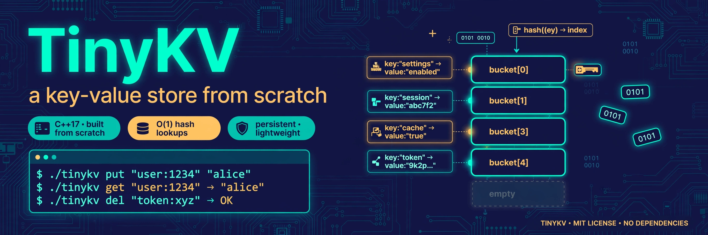

# TinyKV



A tiny **key-value store built from scratch in C++17** — a Redis-lite with its own
hash table, its own persistence layer, and its own TCP server. Zero third-party
dependencies: just the C++ standard library and POSIX sockets.

## Features

- **Hand-rolled hash table** — separate chaining with FNV-1a hashing and dynamic
  resizing at 0.75 load factor. No `std::unordered_map` anywhere in the core.
- **Commands** — `SET` / `GET` / `DEL` / `EXISTS` / `EXPIRE` / `TTL` / `KEYS`
  (glob patterns) / `INCR`, plus `PING`, `DBSIZE`, `SAVE`, `SHUTDOWN`.
- **Key expiry** — per-key TTLs with lazy expiration on access and a background
  sweeper thread.
- **Persistence** — append-only log (AOF) for every mutation plus binary
  snapshots; on startup the server restores the snapshot and replays the log.
- **TCP server** — POSIX sockets, one thread per client, simple line protocol,
  localhost-only binding.
- **CLI client** — interactive REPL and one-shot `--exec` mode.

## Build

```bash
cmake -S . -B build -DCMAKE_BUILD_TYPE=Release
cmake --build build
```

This produces `build/tinykv-server`, `build/tinykv-cli`, and `build/tinykv_tests`.
Built with `-Wall -Wextra`; the build is warning-free.

## Run

```bash
# start the server (port 6379, data in ./tinykv-data)
./build/tinykv-server --port 6379 --dir ./tinykv-data

# talk to it
./build/tinykv-cli --exec "SET user:1234 alice"
./build/tinykv-cli --exec "GET user:1234"
./build/tinykv-cli --exec "EXPIRE user:1234 60"

# or open the interactive REPL
./build/tinykv-cli
```

## Tests

```bash
cmake --build build && ./build/tinykv_tests
# or: ctest --test-dir build
```

A self-contained test runner (no external framework) covers the hash table
(insert/overwrite/erase, 5000-key resize stress, iteration), store semantics
(expiry timing, `INCR` on non-integers, `KEYS` glob patterns), persistence
(snapshot round-trip with TTLs, AOF replay), protocol parsing, and end-to-end
command dispatch. **16 test cases, 74 assertions — all passing.**

## Protocol reference

One command per line, whitespace-separated. `SET` takes the rest of the line as
the value. Replies are single lines:

| Command | Reply | Meaning |
|---|---|---|
| `SET k v` | `+OK` | store (clears any TTL) |
| `GET k` | `$v` / `(nil)` | fetch |
| `DEL k...` | `:n` | number removed |
| `EXISTS k...` | `:n` | number present |
| `EXPIRE k secs` | `:1` / `:0` | set TTL |
| `TTL k` | `:n` | secs left / `-1` persistent / `-2` missing |
| `KEYS pattern` | `$k1 k2` / `(nil)` | glob match (`*` supported) |
| `INCR k` | `:n` | atomic increment |
| `DBSIZE` | `:n` | live key count |
| `SAVE` | `+OK` | write snapshot now |
| `SHUTDOWN` | `+OK` | snapshot + stop the server |

Example session:

```
tinykv> SET lang C++17
+OK
tinykv> GET lang
$C++17
tinykv> INCR hits
:1
tinykv> TTL lang
:-1
```

## Layout

```
src/
  hashmap.{hpp,cpp}    hand-rolled hash table
  kvstore.{hpp,cpp}    store: expiry, AOF, snapshots, thread safety
  protocol.{hpp,cpp}   line-protocol parsing
  commands.{hpp,cpp}   command dispatch
  server_main.cpp      TCP server (POSIX sockets)
  client_main.cpp      CLI client (REPL + --exec)
tests/
  test_main.cpp        self-contained test runner
```

## Tech stack

C++17 · CMake · POSIX sockets · `std::thread`/`std::mutex` · no external
dependencies.

## License

MIT — see [LICENSE](LICENSE).
